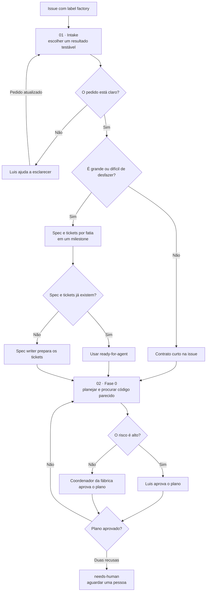
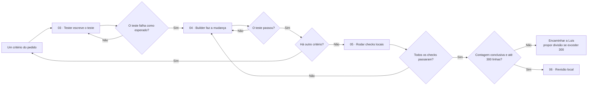
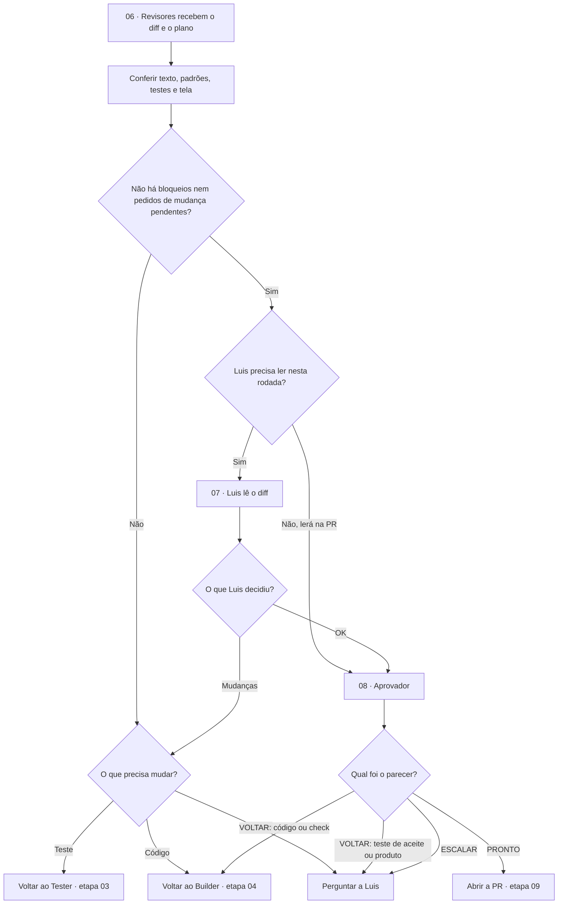
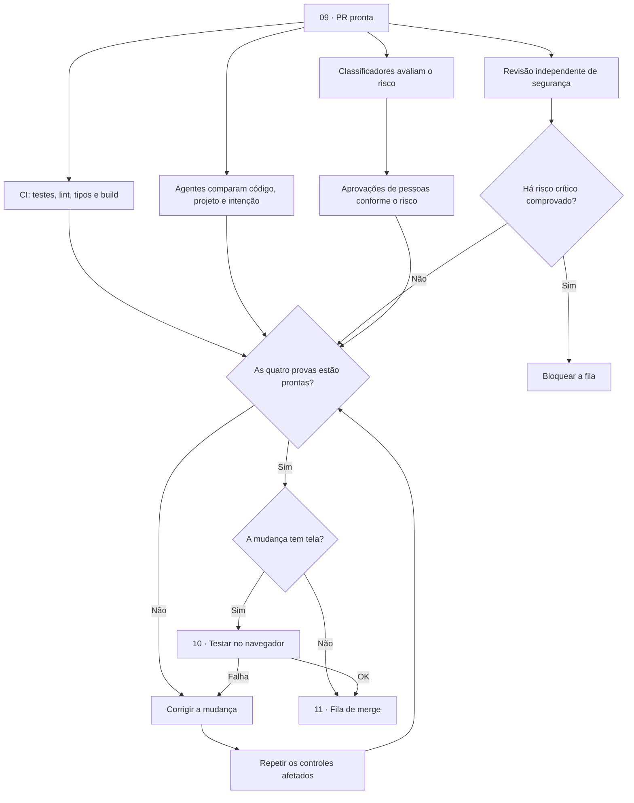
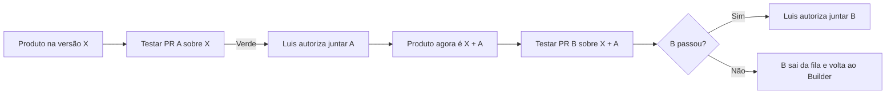
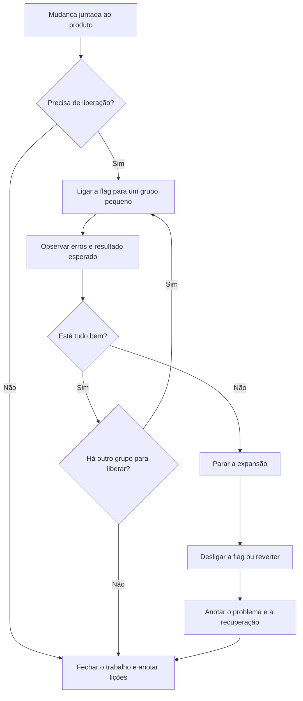
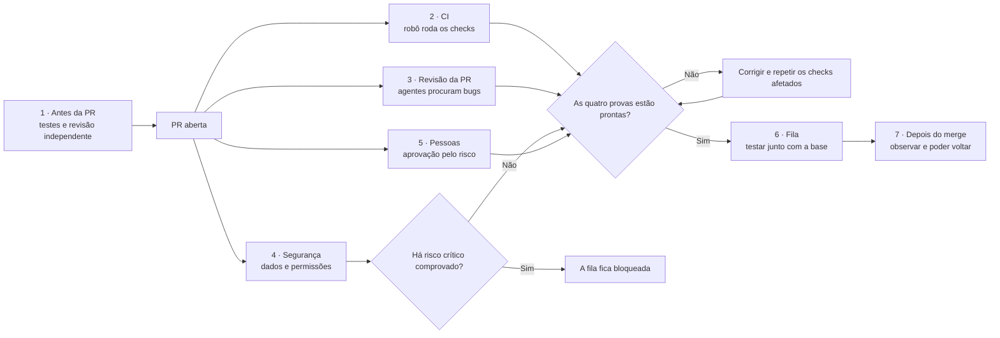
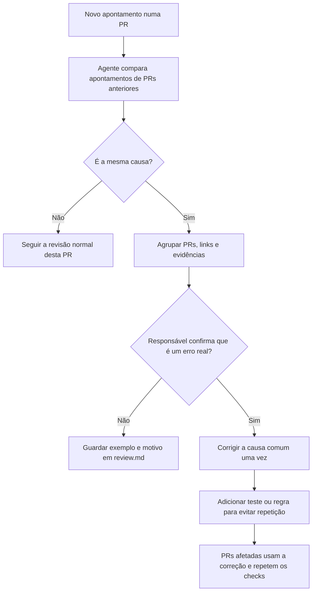

# Fábrica de software

## Executar a primeira entrega

Na raiz deste projeto, abra o Claude Code e execute `/factory run`. É preciso ter Python 3, Claude Code autenticado e GitHub CLI (`gh`) com acesso de leitura a `LuisCarlos-SE/factory-software`.

Abra o painel local indicado ao fim do comando (`factory/jobs/index.html`). Ele lista as issues abertas com a etiqueta `factory`. Cada linha mostra o critério de aceite ou a pergunta que falta responder. Execute o comando novamente e recarregue o painel para atualizar a lista. Os resultados ficam no computador em `factory/jobs/`.

Quando uma issue está pronta, clique em **Abrir plano da Fase 0**. O plano descreve a menor mudança, como verificar o resultado e como desfazer. A versão atual usa o texto da issue e o critério de aceite. Se você alterar o título ou a descrição, a próxima execução refaz a triagem e o plano.

O `/factory run` também conduz as issues prontas com teste cadastrado. O Claude Code roda o teste antes de editar. Se o critério já estiver atendido, segue para a próxima issue. Se o teste falhar pelo motivo esperado, o Builder faz a mudança e roda o mesmo teste de novo. Use `/factory build <n>` para trabalhar em uma só issue.

O `/factory build <n>` reutiliza uma PR aberta da issue ou abre uma em rascunho quando a implementação nova recebe parecer `PRONTO` e uma aprovação independente, com sessão própria distinta do Builder e do revisor. Antes do commit e do push, `factory/build_approval.py` confere o registro, a base remota atual e o SHA-256 do diff; sem essa conferência, a PR não é aberta. A descrição usa o template do repositório e inclui o critério de aceite, os testes e as lacunas. Os pareceres `VOLTAR` e `ESCALAR` registram o motivo e encerram a execução antes de abrir uma PR. O merge depende da autorização de Luis.

## A ideia em poucas palavras

Alguém faz um pedido. A fábrica escolhe uma parte pequena, prepara essa parte, testa o trabalho e pede que outras pessoas confiram. Só depois a mudança entra no produto. Se surgir uma decisão que só uma pessoa pode tomar, a fábrica para e pede ajuda.

O desenho original está em [`factory-software.excalidraw`](factory-software.excalidraw). Este guia explica o mesmo caminho em palavras simples e diagramas.

### Palavras do dia a dia

- **Issue** é o cartão do pedido no GitHub.
- **Intake** é a etapa que entende o pedido e escolhe o primeiro pedaço testável.
- **Tester** é quem prepara um teste para mostrar o que precisa funcionar.
- **Builder** é quem faz a mudança no código.
- **Ticket** é uma tarefa pequena dentro de um trabalho maior.
- **PR** é um pacote de mudanças que outras pessoas conferem antes de juntar ao produto.
- **Merge** é juntar a mudança ao restante do produto.
- **CI** (integração contínua) é um robô que roda testes e outras verificações.
- **Orquestrador** coordena os agentes e encaminha cada trabalho para a próxima etapa.
- **Label** é uma etiqueta que marca um pedido.
- **Branch** é uma cópia separada do código onde se prepara uma mudança.
- **Commit** é um registro salvo de uma mudança no código.
- **SHA** é a identificação de uma versão exata do código.
- **Flag** é um botão liga/desliga que pode esconder uma mudança até ela estar pronta.
- **Spec** é um texto que explica o que precisa ser feito. O **spec writer** ajuda a escrever esse texto e dividir o trabalho em tickets.
- **Milestone** é um grupo de tickets que ajuda a acompanhar um trabalho grande.
- **Diff** é a lista das linhas que mudaram no código.
- **Worktree** é uma pasta separada para trabalhar em uma issue.
- **needs-human** indica que o trabalho está esperando uma pessoa.

## Regras que ainda precisam de confirmação

O último quadro do Excalidraw marca estas regras como propostas para Luis confirmar. A fábrica deve tratá-las como regras depois dessa confirmação.

- Em pedidos simples e claros, a própria issue pode ser o contrato do trabalho.
- Sem CI configurado, a PR espera até haver uma prova verde.
- Toda PR recebe uma revisão de segurança. Um risco crítico com prova bloqueia a fila.
- As aprovações formais seguem o risco, mas Luis autoriza cada merge depois dos checks verdes.
- A PR que junta todas as mudanças de uma funcionalidade repete os controles de CI, revisão, segurança, aprovação e fila sobre o conjunto inteiro.
- A equipe responsável pela liberação observa o lançamento gradual e cuida de parar ou reverter quando necessário.

## O caminho inteiro

Cada número do desenho é uma etapa. As setas que voltam mostram onde corrigir quando algo falha.

```mermaid
flowchart LR
    pedido([Pedido]) --> s1["01 · Intake<br/>entender o pedido"]
    s1 --> s2["02 · Fase 0<br/>fazer um plano"]
    s2 --> s3["03 · Tester<br/>provar o que falta"]
    s3 --> s4["04 · Builder<br/>fazer a menor mudança"]
    s4 -->|"Próximo critério"| s3
    s4 -->|"Todos passaram"| s5["05 · Checks locais<br/>rodar verificações"]
    s5 --> s6["06 · Revisão local<br/>outros olhos conferem"]
    s6 --> s7["07 · Leitura do Luis<br/>quando a regra pedir"]
    s7 --> s8["08 · Aprovador<br/>decidir se abre a PR"]
    s8 --> s9["09 · PR e CI<br/>quatro controles"]
    s9 --> tela{"A mudança tem tela?"}
    tela -->|Sim| s10["10 · Navegador<br/>testar a tela"]
    tela -->|Não| s11["11 · Fila e merge<br/>testar com a base atual"]
    s10 -->|"Passou"| s11
    s11 --> s12["12 · Liberação e lições<br/>observar e aprender"]
```

Se um pedido estiver confuso, se um teste não puder ser repetido ou se houver uma decisão de produto, a fábrica chama uma pessoa. Enquanto espera, registra a pergunta, as opções e uma recomendação em `bloqueio.md`. A vaga de trabalho fica livre para outra issue.

## 01 e 02 · Entender o pedido e fazer o plano

Use a label `factory` para mandar um pedido à triagem. Use `ready-for-agent` quando a especificação e os tickets já estiverem preparados. Nesse caso, o spec writer não precisa prepará-los de novo.

O intake escolhe o menor resultado que já pode ser testado. Para um pedido grande, propõe tickets menores dentro de um milestone e aguarda aprovação antes de criá-los.

Cada PR pode somar até 300 linhas adicionadas e removidas no diff completo. A contagem inclui produção, testes, documentação, comentários, linhas em branco, configurações, migrations, arquivos gerados e lockfiles. Renomes contam como remoção e adição. Arquivos binários ou contagem inconclusiva exigem avaliação humana. Se uma mudança exceder o limite, interrompa a publicação e proponha a decomposição para aprovação de Luis.

O intake lê o pedido e o contexto disponível. Ele não executa comandos no computador. Se o pedido for simples e fácil de desfazer, o próprio texto da issue pode servir de contrato. Se faltar um detalhe técnico, o spec writer registra a suposição. Sem um resultado que possa ser testado, a issue espera a ajuda de Luis.

Na Fase 0, uma ferramenta procura no código exemplos parecidos e os testes que já existem. O builder anota o que pode reaproveitar, quais arquivos serão afetados, como testar e como desfazer a mudança. Um script escolhe os revisores e os modelos de cada tarefa. O resultado fica em `fase0.md`.

## 03 a 05 · Escrever o teste, fazer a mudança e conferir

O tester e o builder trabalham em turnos. Primeiro, o tester prepara um teste que mostra a falha esperada. Depois, o builder faz a menor mudança para corrigir essa falha.

### 03 · Tester

O tester usa a tela ou a interface pública do programa, sem abrir o código de produção. Ele registra o cenário, o critério e a mensagem da falha esperada em `cenarios.md`. O commit do teste guarda a prova de que ele falha antes da correção. Se não conseguir repetir um bug, pede passos ou evidências a uma pessoa.

### 04 · Builder

O builder muda só o necessário e mantém o teste de aceite do tester. Quando o teste passa, registra o que fez e o resultado em `build.md`. Se houver outro critério, o trabalho volta ao tester para preparar o próximo teste.

### 05 · Checks locais

O autor roda testes, lint, checagem de tipos e build. Os testes tentam usar o programa. O lint procura deslizes no código, a checagem de tipos verifica se os dados combinam e o build confere se as partes formam um programa. Também procura coisas que pararam de funcionar e código repetido. O resultado fica em `checks.md`, com o SHA, os comandos e seus resultados. Se o projeto não tiver detector de duplicação, isso fica escrito no relatório.

Cada prova vale para uma versão exata. Um novo commit muda o SHA, então as provas ligadas à versão anterior precisam ser conferidas novamente. O gate de tamanho bloqueia a publicação se o total exceder o limite, se houver arquivo binário ou se a contagem for inconclusiva.

## 06 a 08 · Revisar e decidir se a PR pode ser aberta

### 06 · Revisão local

Revisores diferentes leem o pedido, o plano, os testes e o diff completo em sessões próprias. Eles não conversam com quem escreveu o código. A revisão de tela acontece quando há uma tela. A revisão local de segurança acontece quando a mudança tem risco alto ou toca uma área sensível.

Cada achado aponta o arquivo e a linha. Os pareceres ficam reunidos em `consolidado.md`. A revisão passa quando não há achados marcados como bloqueio nem pedidos de mudança ainda sem resposta. Falha nos testes volta ao tester; problema de código volta ao builder; dúvida sobre o que o produto deve fazer vai para Luis. Depois de cinco rodadas sem resolver o problema, a issue espera uma pessoa.

### 07 · Leitura do diff por Luis

Luis lê todas as rodadas de risco alto. Para risco baixo ou médio, lê a partir da segunda rodada. Se uma mudança de baixo ou médio risco passar logo na primeira, Luis lê a PR antes do merge. Quando esta etapa é chamada, `leitura.md` registra `OK` ou `MUDANÇAS`.

### 08 · Aprovador

O aprovador confere diretamente um critério e verifica as provas dos outros. Também confere o escopo e roda os checks sobre a base atual. O parecer fica em `decisao.md`: `PRONTO`, `VOLTAR` ou `ESCALAR`. Problema no código volta ao builder. Problema no teste de aceite ou numa decisão de produto vai para Luis.

## 09 e 10 · Conferir a PR e testar a tela

O texto da PR explica o que muda, por que muda, qual critério será atendido e qual teste prova isso. Também mostra o teste falhando antes e passando depois, o risco de merge, como revisar, as decisões tomadas sem Luis e qualquer coisa que ainda não foi validada.

### Os quatro controles da PR

1. **CI:** o robô roda lint, tipos, testes e build na versão da PR. Check vermelho, cancelado, ausente ou pendente mantém a PR fora da fila.
2. **Revisão por agentes:** agentes procuram problemas comparando a mudança com todo o projeto e com o pedido. Um grupo separado vota em cada achado. Os votos diferentes ficam registrados, e o código é conferido antes de publicar o comentário. Só achados aceitos por todos viram comentários na PR. Cada comentário tem arquivo, linha e uma marca: `importante` para problema sério, `nitpick` para detalhe pequeno ou `já existente` para algo que já estava no código. Cada revisor pode deixar até três nitpicks.
3. **Segurança:** um revisor independente procura exposição de dados, permissões erradas, segredos e configurações perigosas. Um risco crítico com evidência bloqueia a fila mesmo que os outros revisores discordem. Depois da correção, a mudança volta ao builder e passa por uma nova revisão de segurança.
4. **Aprovação por risco:** um agente dá à mudança uma nota de risco baixa, média ou alta. Outro agente confere essa nota. Se discordarem, vale o nível mais alto até Luis decidir.

| Risco da mudança | Exemplos | Aprovações formais |
| --- | --- | --- |
| Baixo (`low`) | Documentação, textos ou mudança interna atrás de uma flag | 0 |
| Médio (`medium`) | Mudança comum de produto, cache, atualizador automático ou instruções principais da IA | 1 pessoa |
| Alto (`high`) | Caminhos importantes do sistema | 2 pessoas diferentes |

O risco depende da mudança, não de quem escreveu o código. Aprovar a PR e permitir que ela seja juntada ao produto são decisões diferentes. Um commit novo pede novamente o CI e os controles que esse commit afetou.

### 10 · Navegador

Quando há uma tela, o validador repete os mesmos cenários na versão atual e na versão da PR, em um ambiente de teste. Ele grava vídeos do antes e do depois e tira capturas nos passos importantes. `validacao.md` registra `OK`, `FALHOU` ou `PRECISA-VOCE`.

Se o teste falhar, o vídeo volta ao builder. Senha ou dado real pede ajuda humana. Se não houver aplicativo configurado para testar, registrar o aviso na PR e continuar para a fila.

## 11 · Fila e merge

A fila testa a mudança junto com a versão mais nova do produto. Assim, o teste mostra o que acontecerá quando as duas partes forem juntadas.

Se a versão do produto mudar enquanto uma PR espera, a fila testa tudo de novo com a versão nova. A prova verde guarda o SHA da PR e o SHA da base usada. Luis autoriza o merge squash, que junta os commits da PR em um só, inclusive para mudanças de baixo risco. Depois do merge, o GitHub registra o SHA integrado em `job.json`.

## 12 · Liberar, observar e aprender

Juntar o código não significa que todos precisam ver a mudança imediatamente. Quando há uma liberação, ela começa escondida atrás de uma flag. Antes de começar, a equipe decide o que observar, por quanto tempo e quem pode parar. Ela observa um grupo pequeno. Se tudo estiver bem, o responsável pela liberação autoriza o próximo grupo. Se algo quebrou, a equipe para a expansão, desliga a flag ou desfaz a mudança e registra quem foi afetado.

`handoff.md` e `encerramento.md` guardam o que foi liberado, o que aconteceu e as lições. Esses registros apontam para a PR e para o SHA, mesmo que o trabalho já esteja fechado. O script encerra as sessões e remove a worktree, a pasta separada daquela issue. Luis decide quais lições, pedidos cortados e correções adiadas viram tarefas. Issues aprovadas começam sem a label `factory`.

Quando a fábrica aprende algo, ela guarda no lugar certo:

- Erro que pode ser testado de novo vira teste, lint ou regra em `checks.sh`.
- Orientação para escrever código vai para `CLAUDE.md` ou uma skill.
- Falso alarme repetido vai para o `review.md` do projeto, com exemplo e motivo.

## Sete camadas de proteção

Pense em sete portões. Cada portão procura um tipo de problema antes ou depois de juntar a mudança.

A camada 1 acontece antes da PR, nas etapas 04 a 06. As camadas 2 a 5 cuidam da PR na etapa 09. A camada 6 é a fila da etapa 11. A camada 7 acompanha a liberação na etapa 12. Uma prova deve sempre apontar para a versão que foi testada.

### Agente para achados repetidos

Um agente compara os apontamentos de cada PR com os de PRs anteriores. Como no desenho das PRs 12 a 15, ele junta links e evidências quando acha o mesmo problema e pergunta ao responsável pelo código se é um erro real. O agente identifica e agrupa os casos. O responsável confirma a causa.

Se várias PRs mostram o mesmo erro pela mesma causa, a fábrica prepara uma correção compartilhada em vez de repetir o mesmo conserto em cada PR. Cada PR afetada aponta para essa correção e roda novamente os checks que ela alterou. A PR continua bloqueada até a correção compartilhada e suas provas estarem prontas. Problemas diferentes seguem a revisão normal.

Se o apontamento for um falso positivo, registrar um exemplo e o motivo no `review.md` do projeto para o revisor não repetir o aviso. O arquivo pertence a quem cuida daquele código e ajuda a revisar pontos como documentação que contradiz o programa ou configuração que aponta para o ambiente errado. Cada achado precisa indicar arquivo e linha.

O que se confirma como problema real vira memória duradoura: teste, regra em lint ou `checks.sh`, ou instrução em `CLAUDE.md` ou numa skill. Assim, os agentes reconhecem o padrão nas próximas PRs e o time evita gastar tempo com correções duplicadas.

## Dashboard e revisão semanal

O dashboard mostra cada pedido, em qual etapa está, seu risco e quais provas já existem. O protótipo em [`dashboard/prototype-esteira.html`](dashboard/prototype-esteira.html) usa dados de exemplo. Ele mostra a aparência desejada, ainda sem ler os dados reais da fábrica.

Uma vez por semana, a fábrica revisa as provas das tarefas, procura problemas que se repetem e sugere melhorias. O relatório vai para `docs/afericao-semanal/` e diz o que foi observado, qual foi o impacto e o que fazer. As ideias aprendidas também podem ser organizadas em [`aprendizado.excalidraw`](aprendizado.excalidraw), usando as fontes reunidas no NotebookLM e no vault do Obsidian.

## Referências de estudo

- Claude Code, [“How the Claude Code team does code review”](https://claude.dev/blog/solving-code-review-at-anthropic/) (15 out. 2026).
- [“(When) Should a Software Factory be Lights-off? Benchmarking Code Review Agents on Bug Detection”](https://arxiv.org/abs/2610.13668) (9 out. 2026).
- [“TestSuiteBench: Coding Agents Struggle to Generate Strong Test Suites from Specifications”](https://arxiv.org/abs/2610.13065) (9 out. 2026).
- [“Who Finishes the Job? A Study of Follow-Up Fixes and Commit Authorship on AI Coding Agent Pull Requests”](https://arxiv.org/abs/2609.26847) (22 set. 2026).
- [ts-rust (tsc-rs), repositório e README](https://github.com/pingdotgg/ts-rust).
